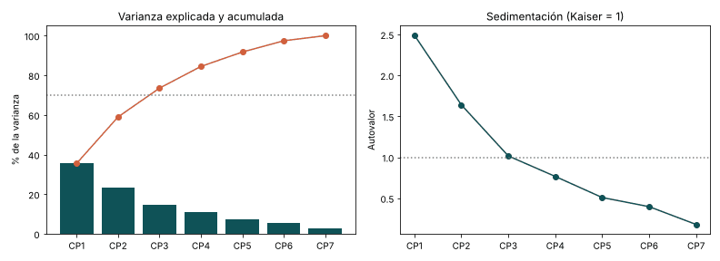
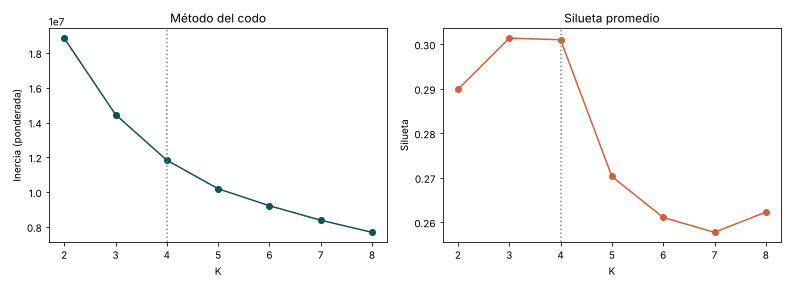
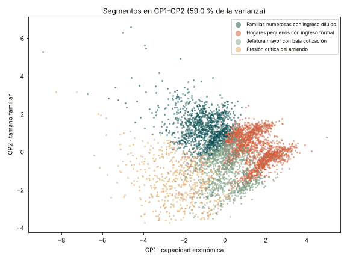
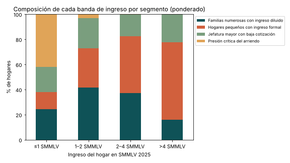

# ¿Quiénes son los hogares que viven en arriendo en Cali A.M.?

**Perfiles económicos de los arrendatarios con Análisis de Componentes Principales (ACP) y K-Means · GEIH 2025**

Taller individual · Machine Learning aplicado a Economía y Finanzas · Pontificia Universidad Javeriana Cali
Autor: Martin Felipe Galeano Maya

**Aplicación:** https://arrendatarios-cali.streamlit.app
**Video de sustentación:** _(pendiente)_

---

## 1. Contexto y pregunta

En Cali A.M. viven en arriendo cerca de **452.654 hogares** en un mes promedio de 2025. La política de vivienda suele clasificarlos por una sola variable, su ingreso en salarios mínimos (SMMLV). Pero dos hogares con el mismo ingreso pueden tener situaciones muy distintas: un hogar de dos personas con empleo formal no se parece a una familia de cinco con un solo perceptor informal.

> **Pregunta:** ¿qué perfiles de hogares arrendatarios existen en Cali A.M. y en qué se diferencian sus condiciones para avanzar hacia la vivienda propia?

**Por qué ACP y K-Means.** Las condiciones del hogar están correlacionadas: ingreso por persona, número de perceptores, cotización a pensión y carga del arriendo se mueven juntas. El ACP resume esa información en pocas dimensiones interpretables. K-Means busca grupos de hogares con combinaciones parecidas sin imponer un corte de ingreso de antemano. Comparar esos grupos con las bandas de SMMLV permite evaluar si la clasificación por ingreso esconde perfiles distintos.

## 2. Datos

| Aspecto | Detalle |
|---|---|
| Fuente | Gran Encuesta Integrada de Hogares (GEIH), DANE, enero–diciembre de 2025. Microdatos públicos y anonimizados |
| Cobertura | Dominio Cali A.M. (**Cali–Yumbo**, `AREA = 76`), hogares en arriendo (`P5090 = 3`) |
| Unidad | Hogar en un mes. Los 12 meses son cortes transversales independientes (no es un panel) |
| Tamaño | 5.279 hogares-mes; 4.968 en la base analítica |
| Ponderación | `FEX_C18`. Un mes promedio = Σ factores de los 12 meses / 12 |
| Archivo del repositorio | `data/arrendatarios_cali_2025.parquet` (80 KB, sin identificadores) |

**Variables del modelo (7 cuantitativas)**

| Variable | Construcción | Dimensión |
|---|---|---|
| Ingreso por persona (log) | Ingreso del hogar / personas, en logaritmo | Capacidad económica |
| Carga del arriendo (%) | `P5140` / ingreso del hogar × 100, recortada en 100 | Presión del arriendo |
| Personas en el hogar | Miembros del hogar (sin servicio doméstico, pensionistas ni trabajadores residentes) | Composición |
| Personas por dormitorio | Personas / `P5010` | Hacinamiento |
| Edad de la persona de referencia | `P6040` de `P6050 = 1` | Ciclo de vida |
| Perceptores laborales / personas | Ocupados con `INGLABO` > 0 / personas | Dependencia económica |
| Perceptores que cotizan a pensión (%) | `P6920 = 1` entre perceptores laborales | Proxy de formalidad |

**Ingreso del hogar (reconstrucción propia, no es una variable oficial del DANE).** Es la suma de `INGLABO` de cada ocupado más los arriendos recibidos, pensiones y pensión alimenticia del último mes (`P7500S1–S3`), y las transferencias del país y del exterior, ayudas institucionales y rentas financieras de los últimos 12 meses divididas por 12 (`P7510S1–S3, S5`). Las personas de 10 a 14 años no responden el módulo de otros ingresos, así que aportan 0. Si un monto aparece como 98/99 o un ocupado no reporta ingreso, el hogar queda fuera; no se imputa.

**Limitaciones de la fuente.** La GEIH no observa ahorro acumulado, deudas, historial crediticio, intención de compra ni aprobación hipotecaria. La cotización a pensión es un proxy parcial de formalidad. El margen después del arriendo no es ahorro. Los Parquet no traen variables de diseño muestral (estrato, UPM), así que no se calculan errores estándar.

## 3. Metodología

1. **Preparación.** Excluí 14 hogares con canon 98/99, 220 con ingreso incompleto y 77 con ingreso cero (quedan 4.968). No hay duplicados. Recorté la carga en 100 % para que unos pocos hogares con ingreso muy bajo no dominen las distancias (la carga original se conserva en los perfiles). Después apliqué logaritmo al ingreso por persona y estandaricé todas las variables (media 0, desviación 1).
2. **ACP.** Se usan autovalores, varianza explicada y acumulada, gráfico de sedimentación, cargas y biplot. Conservé **3 componentes** (criterio de Kaiser, autovalor > 1), que resumen el **73,5 %** de la varianza.
3. **K-Means** sobre los 3 componentes, ponderado con `FEX_C18`, con semilla 42 y 20 inicializaciones. Comparé K = 2…8 con el método del codo y la silueta, y elegí **K = 4**.
4. **Perfiles** con las variables originales: medianas ponderadas para montos y promedios ponderados para composición.

## 4. Resultados principales



**Componentes**

| | Varianza | Variables que lo definen (cargas) | Lectura |
|---|---|---|---|
| CP1 | 35,6 % | Ingreso por persona (+0,88), perceptores (+0,77), cotización (+0,47); carga (−0,57), personas (−0,57) | Capacidad económica |
| CP2 | 23,4 % | Personas (+0,66), hacinamiento (+0,64), cotización (+0,48); carga (−0,61), edad (−0,42) | Tamaño familiar frente a presión relativa |
| CP3 | 14,5 % | Edad (+0,84) | Ciclo de vida |

**Elección de K.** La silueta es prácticamente igual con K = 3 y K = 4 (0,301) y cae desde K = 5. El codo se suaviza en K = 4. Elegí K = 4 porque, con una calidad equivalente, separa un grupo que con K = 3 quedaba mezclado: los hogares con persona de referencia mayor y baja cotización.



**Segmentos (K = 4, silueta promedio 0,30)**

| Segmento | % de arrendatarios | Ingreso del hogar (mediana) | Ingreso por persona | Carga (mediana) | Personas | Cotizan |
|---|---|---|---|---|---|---|
| Hogares pequeños con ingreso formal | 33,9 % | $3.103.500 | $1.623.500 | 21,5 % | 2,0 | 75 % |
| Familias numerosas con ingreso diluido | 32,8 % | $2.263.500 | $594.444 | 25,9 % | 4,2 | 58 % |
| Jefatura mayor con baja cotización | 20,9 % | $2.135.250 | $1.026.000 | 30,4 % | 2,3 | 24 % |
| Presión crítica del arriendo | 12,4 % | $680.000 | $266.667 | 90 % | 2,8 | 5 % |



**Lo que más me llamó la atención.** Los hogares con ingreso entre 2 y 4 SMMLV (la banda en la que suelen enfocarse los programas de compra de vivienda) **no forman un grupo homogéneo**: 45 % son hogares pequeños con ingreso formal, 37 % familias numerosas con ingreso diluido y 17 % hogares con jefatura mayor y baja cotización. Con el mismo ingreso total, su ingreso por persona y su cotización difieren mucho. Para el acceso al crédito y la capacidad de pago, eso importa.



**¿Qué tan claros son los grupos?** Una silueta de 0,30 indica una estructura moderada: los perfiles son útiles para describir, pero los bordes son difusos y los arrendatarios se parecen más a un continuo con zonas de concentración que a grupos aislados. Aun así, la partición es **estable**:

| Prueba de robustez | ARI promedio (1 = misma partición) |
|---|---|
| Otras 10 semillas aleatorias | 0,98 |
| 20 submuestras del 80 % de los hogares | 0,95 |
| Con y sin el factor de expansión | 0,86 |
| Todas las variables estandarizadas en vez de los 3 componentes | 0,79 |

**Relación con el problema.** Para una política de acceso a vivienda propia, un programa definido solo por ingreso trataría igual a hogares con capacidades distintas. El segmento de **familias numerosas** tiene un ingreso del hogar compatible con la banda, pero un ingreso por persona bajo, lo que limita la cuota que pueden pagar sin sacrificar consumo esencial. La **jefatura mayor con baja cotización** probablemente tendría más dificultad para demostrar su ingreso ante una entidad financiera y menos años de plazo para un crédito. Los **hogares pequeños con ingreso formal** son los que más se acercan, por lo que observa la GEIH, a las condiciones de financiación (aunque la encuesta no mide su ahorro). La **presión crítica** necesita alivio del arriendo antes que apoyo para comprar.

## 5. Cómo ejecutar

```bash
git clone https://github.com/martinfgaleano-crypto/taller-acp-kmeans-arrendatarios-cali.git
cd taller-acp-kmeans-arrendatarios-cali
pip install -r requirements.txt
streamlit run app.py
```

La app lee `data/arrendatarios_cali_2025.parquet` y calcula en vivo la preparación, el ACP, K-Means, las métricas y los gráficos (`src/analisis.py`). En la barra lateral se pueden cambiar las variables, el recorte de la carga, el número de componentes, K y la ponderación.

**Reconstruir la base desde los microdatos.** Descarga la GEIH 2025 del catálogo de microdatos del DANE (https://microdatos.dane.gov.co), une los módulos mensuales en `personas_2025-MM.parquet` y `hogares_2025-MM.parquet` (llave `PERIODO + DIRECTORIO + SECUENCIA_P + HOGAR`, más `ORDEN` en personas) y ejecuta:

```bash
python src/preparar_datos.py --geih <carpeta_con_los_24_parquet>
```

**Reproducir las tablas y figuras de este README sin abrir la app:**

```bash
python src/reproducir_resultados.py
```

| Resultado | Archivo generado | Función |
|---|---|---|
| Embudo de preparación | `resultados/01_preparacion.csv` | `analisis.preparar` |
| Varianza y autovalores del ACP | `resultados/02_varianza_acp.csv`, `docs/figuras/acp_varianza.png` | `analisis.acp` |
| Cargas | `resultados/03_cargas_acp.csv` | `ResultadoACP.cargas` |
| Codo y silueta (K = 2…8) | `resultados/04_codo_silueta.csv`, `docs/figuras/kmeans_k.png` | `analisis.evaluar_k` |
| Estabilidad (ARI) | `resultados/05_estabilidad.csv` | `analisis.estabilidad` |
| Perfiles de los segmentos | `resultados/06_perfiles_segmentos.csv` | `analisis.perfiles` |
| Bandas de SMMLV por segmento | `resultados/07_banda_por_segmento.csv`, `docs/figuras/bandas_segmentos.png` | `reproducir_resultados.py` |

Prueba automática de las 7 páginas de la app: `python tests/test_app.py`.

## 6. Estructura

```
app.py                         Aplicación Streamlit (7 secciones, cálculo en vivo)
src/analisis.py                Preparación, ACP, K-Means, estabilidad, perfiles
src/preparar_datos.py          Construcción de la base desde los microdatos GEIH
src/reproducir_resultados.py   Tablas y figuras del README
data/arrendatarios_cali_2025.parquet
resultados/                    Tablas generadas
docs/figuras/                  Figuras generadas
tests/test_app.py              Prueba de humo de la app
requirements.txt
.streamlit/config.toml         Identidad visual
```

## 7. Limitaciones del análisis

- Los segmentos describen **condiciones**, no elegibilidad para comprar vivienda.
- El ACP se estima sobre la muestra sin ponderar. Los tamaños y perfiles sí se expanden con `FEX_C18`.
- K-Means supone grupos aproximadamente esféricos y es sensible a valores extremos; por eso se recortó la carga del arriendo.
- Los perfiles cambian algo si se quita la ponderación o se trabaja con todas las variables (ARI 0,86 y 0,79), así que las cifras de cada segmento deben leerse como aproximadas.
- El análisis es descriptivo y no implica causalidad.

**Uso de IA.** Me apoyé en herramientas de inteligencia artificial durante el desarrollo. Las decisiones metodológicas, el código y los resultados fueron revisados y puedo sustentarlos.
